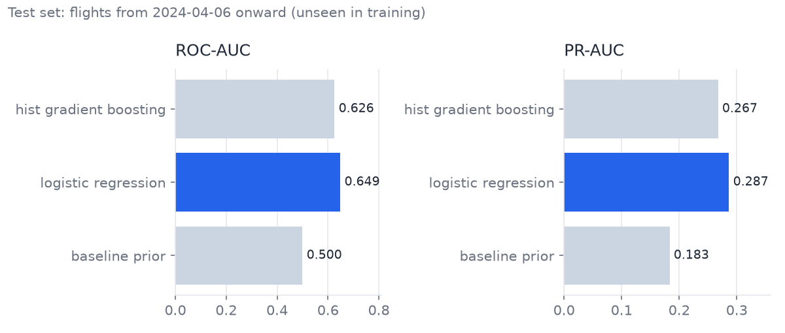
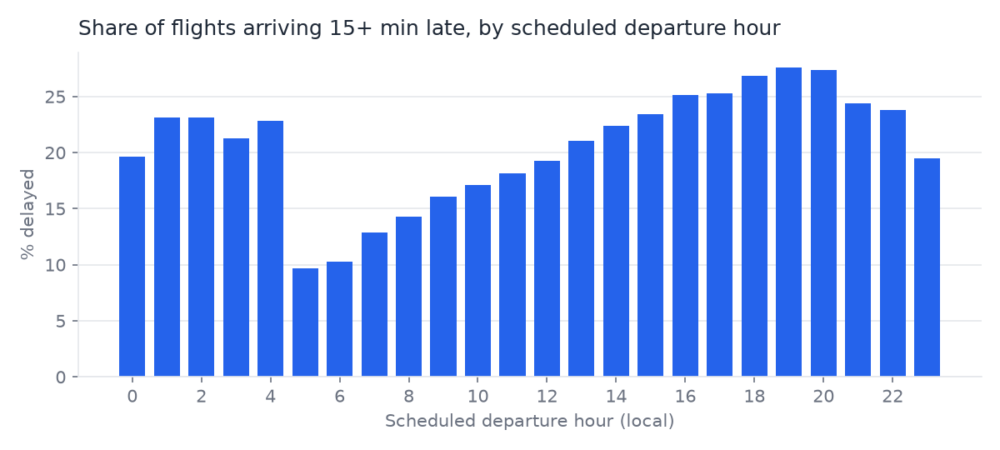

# Airline Flight Delay Prediction

[](https://github.com/harshithkonatham/prediction-for-airline-flight-delays/actions/workflows/ci.yml)

Predicts whether a US domestic flight will arrive **15+ minutes late**, using only
information known **before departure**. This started as my MSc Data Science
dissertation at Middlesex University. I rebuilt it as a tested data pipeline and
prediction API with a security-gated CI pipeline.

**At a glance**

- **Data:** 2.24 M flights (Jan–Apr 2024) from the US Bureau of Transportation
  Statistics, ingested with DuckDB into Parquet and checked by 14 data-quality rules.
- **Model:** best is logistic regression, with **ROC-AUC 0.65 / PR-AUC 0.29** on
  480 k later flights it never saw (baseline: 0.50 / 0.18).
- **Service:** FastAPI `/predict` with strict input validation, in a non-root,
  read-only container scanned for CVEs, with an SBOM on every build.
- **Quality:** 60 tests (unit, integration, end-to-end) at 98% coverage, strict
  mypy, Ruff, Bandit, Semgrep, Gitleaks, pip-audit, Hadolint and Checkov in CI.

## What changed from the dissertation, and why

The [original notebook](notebooks/01-dissertation-original.ipynb) reported
**100% accuracy**. That came from **target leakage**, not from a good model:

- The target was `ArrDelayMinutes >= 15`, and `ArrDelayMinutes` itself was one
  of the inputs.
- `DepDelayMinutes`, `WeatherDelay` and `NASDelay` were inputs too. All are
  only known after the flight has left.
- A random train/test split put flights from the same days in both sets.

The rebuild fixes all three:

| Problem | Fix | Where |
|---|---|---|
| Answer used as an input | Only pre-departure features. The pipeline refuses to run if a post-departure column is in the feature list. | [`features.py`](src/flightdelay/features.py), [`config.py`](src/flightdelay/config.py) |
| Over-optimistic evaluation | Time-based split: train on earlier dates, test on later ones | [`train.py`](src/flightdelay/train.py) |
| No reference point | A prior-only baseline every model must beat | [`train.py`](src/flightdelay/train.py) |

An honest 0.65 ROC-AUC is the more useful result. Most delay is caused by things
that happen on the day (weather, late inbound aircraft, congestion), which a
schedule can't fully show.

## Results



| Model | ROC-AUC | PR-AUC | Precision | Recall | F1 |
|---|---|---|---|---|---|
| Baseline (always predicts the average rate) | 0.500 | 0.183 | – | 0.00 | 0.00 |
| **Logistic regression** | **0.649** | **0.287** | 0.28 | 0.48 | 0.35 |
| Histogram gradient boosting | 0.626 | 0.267 | 0.24 | 0.63 | 0.35 |

Trained on 1 M sampled flights up to 5 April 2024 and tested on all 480,600
flights from 6 April onward, of which 18.3% were delayed. Full numbers are in
[`reports/results.json`](reports/results.json).

**What the data shows**



- Delays build up through the day: **9.7%** of 5 am departures arrive late,
  against **27.6%** at 7 pm, as knock-on delays accumulate.
- Airlines differ a lot, from 11.4% (YX) to 27.4% (F9) delayed. See
  [`delay_by_airline.png`](reports/figures/delay_by_airline.png).
- Gradient boosting did slightly worse than logistic regression here. With four
  months of data the test month (April) is barely in training, so `month` is
  out of range for the tree model. More history (a full year or more) is the
  first thing to add.

## How it works

```text
BTS monthly zip ──► ingest ──► bronze Parquet ──► quality checks ──► features ──► train ──► model + metadata
 (HTTPS only,        (typed,     (partitioned       (14 rules; errors   (DuckDB SQL,   (time split,   (SHA-256 recorded,
  size-capped)        zip-slip    by year/month)     stop the run)       pre-departure  3 models,      verified on load)
                      safe)                                              only)          best PR-AUC)
                                                                                               │
                                                                     FastAPI /predict ◄───────┘
```

| Stage | Module | Notes |
|---|---|---|
| Ingest | [`ingest.py`](src/flightdelay/ingest.py) | Atomic downloads (temp file + rename), size limits against zip bombs, CSV read under a fixed name so archive paths can't escape (zip slip) |
| Validate | [`quality.py`](src/flightdelay/quality.py) | Schema, nulls, valid times and airport codes, origin ≠ destination, missing arrivals. JSON report saved every run |
| Features | [`features.py`](src/flightdelay/features.py) | DuckDB SQL with bound parameters. Adds airport congestion (departures from that airport in that hour) |
| Train | [`train.py`](src/flightdelay/train.py) | Baseline, logistic regression, gradient boosting. The model file's hash is checked before loading, because joblib files can run code |
| Serve | [`api.py`](src/flightdelay/api.py) | Rejects unknown fields, bad codes and impossible times. `/health` vs `/ready`. Security headers |

## Run it

Needs [uv](https://docs.astral.sh/uv/).

```bash
make install
make test                                        # 60 tests, no network needed
uv run flightdelay run --year 2024 --months 1 2 3 4   # download (~110 MB), validate, train
make api                                         # http://localhost:8000/docs
```

```bash
curl -s localhost:8000/predict -H 'content-type: application/json' -d '{
  "flight_date": "2024-04-19", "airline": "B6", "origin": "JFK", "dest": "FLL",
  "scheduled_departure": 1915, "scheduled_arrival": 2215,
  "scheduled_minutes": 180, "distance_miles": 1069}'
# {"delay_probability":0.7316,"likely_delayed":true,"model_version":"logistic_regression@91d8d5ba2d86"}
# A 6 am YX flight ORD→DCA scores 0.2372 (likely on time). Scores rank flights
# by risk; they are not calibrated probabilities yet (see Next steps).
```

With Docker (the model is mounted read-only, not baked into the image):

```bash
make docker
docker run --rm -p 8000:8000 --read-only --tmpfs /tmp --cap-drop ALL \
  --security-opt no-new-privileges -v "$PWD/artifacts/models:/models:ro" flightdelay-api
```

## CI pipeline

[`.github/workflows/ci.yml`](.github/workflows/ci.yml) runs on every push, plus
a weekly re-scan for new CVEs:

```text
 test     ruff · mypy --strict · pytest (≥85% coverage gate)          ─┐
 sast     Bandit · Semgrep (Python, OWASP Top 10, secrets)             │
 secrets  Gitleaks over full git history                               ├─► image: build → Grype CVE scan → SBOM
 deps     pip-audit on locked runtime dependencies                     │         → run read-only, no capabilities
 docker   Hadolint · Checkov                                          ─┘         → smoke-test /ready, /predict, bad input → 422
```

Actions are pinned to commit SHAs, each job has least-privilege permissions, and
Dependabot proposes updates for actions, Python packages and the base image.

## Repository layout

```text
src/flightdelay/   pipeline package and API
tests/             unit, integration and end-to-end tests (synthetic data, no network)
scripts/           chart generation for this README
reports/           committed results and figures
notebooks/         original dissertation notebook (kept for reference)
docs/dissertation/ proposal, report and poster
```

## Next steps

- Train on 2+ years so seasonality can be learned, then re-test gradient boosting.
- Add leakage-safe history features, e.g. the route's delay rate over the previous 30 days.
- Calibrate probabilities (the model is trained with balanced class weights).
- Schedule monthly ingestion and track how the model's accuracy drifts over time.
